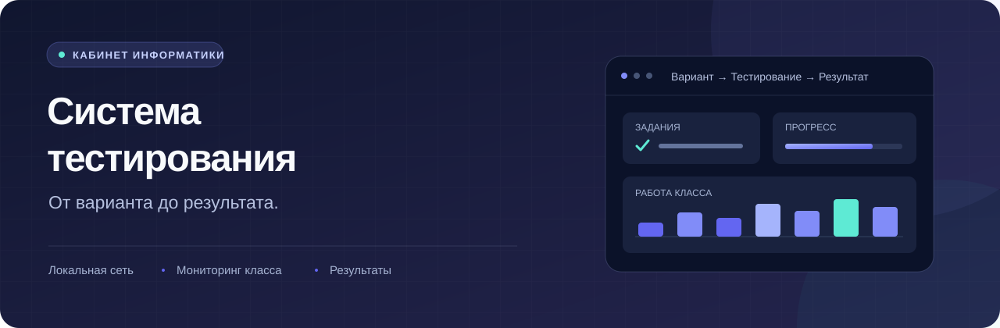
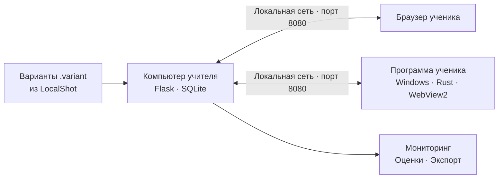

<div align="center">



<br>

**ЕГЭ и школьные проверочные в кабинете информатики**

Учитель запускает работу на своём компьютере. Ученики решают её по локальной сети.

[](https://github.com/kuzmin-lemmi/testing-sistem/actions/workflows/ci.yml)
[](https://github.com/kuzmin-lemmi/testing-sistem/actions/workflows/student_app.yml)


[Быстрый старт](#быстрый-старт) · [Инструкция учителю](ИНСТРУКЦИЯ.md) · [Документация](docs/README.md) · [Разработка](CONTRIBUTING.md)

</div>

---

## От варианта до результата

Система помогает провести проверочную целиком: загрузить задания, распределить варианты, проследить за работой класса и получить оценки. Сервер и база SQLite находятся на компьютере учителя; ученики подключаются из браузера или программы для Windows.

| Подготовить | Провести | Разобрать |
| --- | --- | --- |
| Импортировать `.variant` из LocalShot, найти работу по классу и теме, выбрать комплект вариантов | Задать время, перемешать задания, видеть прогресс и уходы со страницы, поставить паузу или продлить работу | Получить оценки и ответы, посмотреть время на заданиях, выгрузить результаты для журнала |

### Что внутри

- **Каталог вариантов.** Поиск, классы, темы, комплекты и загрузка нескольких файлов за раз.
- **Мониторинг класса.** Подключения, число ответов, оставшееся время, сдача и завершение работы отдельного ученика.
- **Рабочее место ученика.** Задания, вложения, сохранение ответов и загрузка файлов `.ods` / `.odt`.
- **Python рядом с заданием.** В программе ученика код выполняется установленным на его компьютере Python.
- **Разбор результатов.** Оценки, ответы, время решения и совпадающие неверные ответы, которые учитель может проверить.
- **Резервные копии.** При запуске системы и после завершения тестирования; сохраняются последние 20 копий.

## Как это работает



Панель учителя по умолчанию доступна только с его компьютера. Адрес для учеников отображается на главной странице системы.

## Быстрый старт

### Если у вас готовый комплект

Откройте `Тестирование.exe` в папке программы учителя. В браузере появится главная страница с адресом для учеников.

Пошагово: [инструкция для учителя](ИНСТРУКЦИЯ.md) · [установка в школе](docs/УСТАНОВКА_ПРОГРАММЫ_УЧЕНИКА.md).

### Запуск из исходников на Windows

Нужны **Python 3.8+**, **Git** и общая локальная сеть с компьютерами учеников. Команды ниже — для PowerShell:

```powershell
git clone https://github.com/kuzmin-lemmi/testing-sistem.git
cd testing-sistem
py -m venv .venv
.\.venv\Scripts\python.exe -m pip install -r requirements.txt
.\.venv\Scripts\python.exe launcher.py
```

Панель учителя: **[http://127.0.0.1:8080](http://127.0.0.1:8080)**.

При первом подключении учеников проверьте предупреждение о брандмауэре на главной странице. Если оно появилось, нажмите **«Открыть доступ ученикам»**; для этого действия Windows запросит права администратора.

Для запуска из исходников также предусмотрен `УСТАНОВКА.bat`, а затем `start.bat` — см. [инструкцию](ИНСТРУКЦИЯ.md).

### Первая проверочная

1. Откройте **«Варианты» → «Загрузить из LocalShot»** и выберите файл `.variant`.
2. Нажмите **«Запустить тестирование»**, выберите варианты и задайте время.
3. Передайте ученикам адрес с главной страницы или скачайте для них HTML-ярлык.
4. Следите за работой в **«Мониторинге»**, затем завершите тестирование и откройте **«Результаты»**.

Файл `.variant` содержит правильные ответы — храните его у учителя.

## Программа ученика

Отдельное приложение для **Windows 10/11** открывает тест на весь экран, ищет компьютер учителя в локальной сети и передаёт сведения об уходах. Для встроенного окна нужен **WebView2 Runtime**, для выполнения кода — **Python 3** на компьютере ученика.

**Статус: прототип.** Режим отдельного рабочего стола проверен на компьютере учителя; проверка на компьютерах учеников ещё предстоит. Перед использованием с классом пройдите [план проверки в школе](docs/ПЛАН_ПРОВЕРКИ_В_ШКОЛЕ.md).

[Возможности, сборка и ограничения](student_app/README.md) · [Установка на компьютеры учеников](docs/УСТАНОВКА_ПРОГРАММЫ_УЧЕНИКА.md)

## Данные и настройки

| Что | Где |
| --- | --- |
| База, варианты, ответы и вложения | `data/` при запуске из исходников; `Данные/` рядом с готовой программой |
| Резервные копии | `data/backups/` или `Данные/backups/` |
| Журнал системы | `data/logs/server.log` или `Данные/logs/server.log` |

При обновлении сохраняйте папку данных. Для переноса на другой компьютер скопируйте её целиком.

<details>
<summary><strong>Настройки через переменные окружения</strong></summary>

<br>

| Переменная | Назначение |
| --- | --- |
| `EGE_DATA_DIR` | Отдельная папка данных, например для разработки |
| `TEACHER_ALLOWED_IPS` | IP-адреса с доступом к панели учителя, через запятую; по умолчанию `127.0.0.1,::1` |
| `EGE_BANKS=1` | Показать банки заданий по номерам ЕГЭ |
| `EGE_ACCESS_CODE=1` | Показать настройку входа по коду доступа |

Полная конфигурация: [config.py](config.py).

</details>

## Навигация по проекту

| Раздел | Содержимое |
| --- | --- |
| [`server.py`](server.py), [`blueprints/`](blueprints/) | Сервер Flask и маршруты учителя и ученика |
| [`models.py`](models.py), [`results_logic.py`](results_logic.py) | SQLite, миграции, оценки и результаты |
| [`catalog.py`](catalog.py), [`localshot_import.py`](localshot_import.py) | Каталог и импорт вариантов |
| [`templates/`](templates/), [`static/`](static/) | Страницы, стили и скрипты |
| [`student_app/`](student_app/) | Программа ученика на Rust |
| [`tests/`](tests/) | Автоматические проверки |
| [`docs/`](docs/README.md) | Установка, проверка в школе и планы |

Хотите улучшить проект? Начните с [руководства для участников](CONTRIBUTING.md). Об ошибке можно сообщить в [Issues](https://github.com/kuzmin-lemmi/testing-sistem/issues/new/choose).
